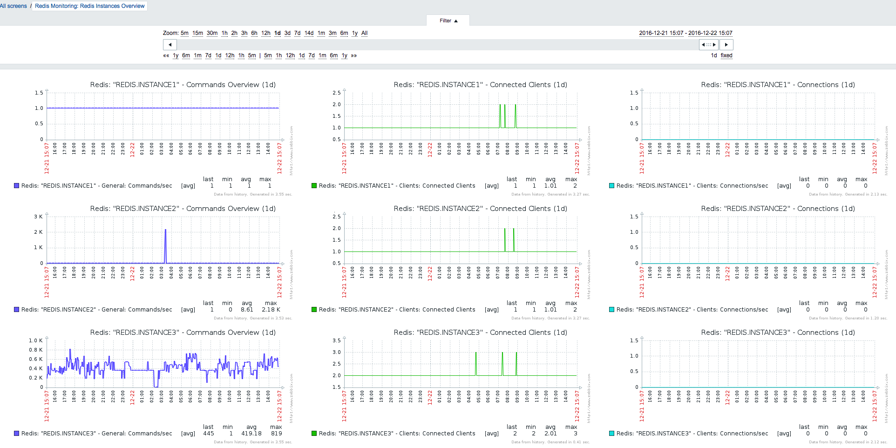
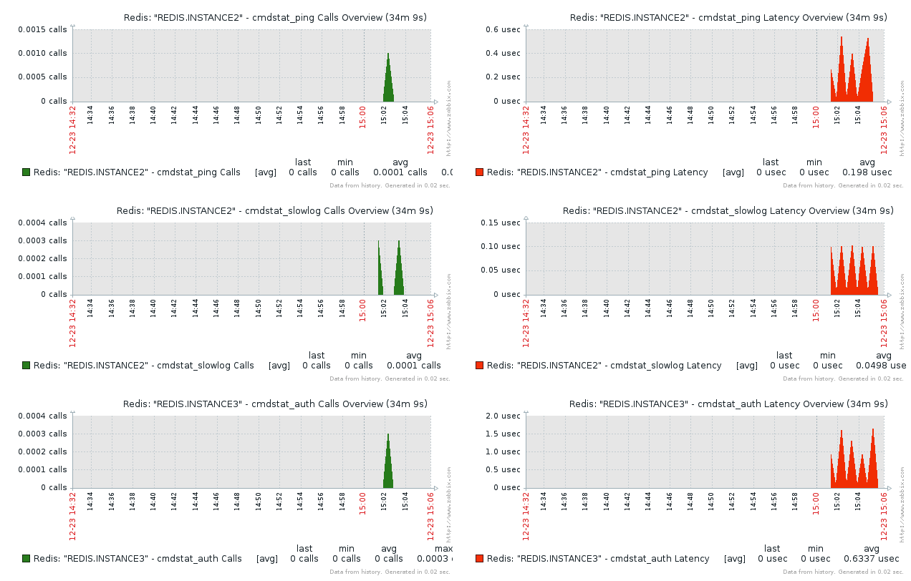
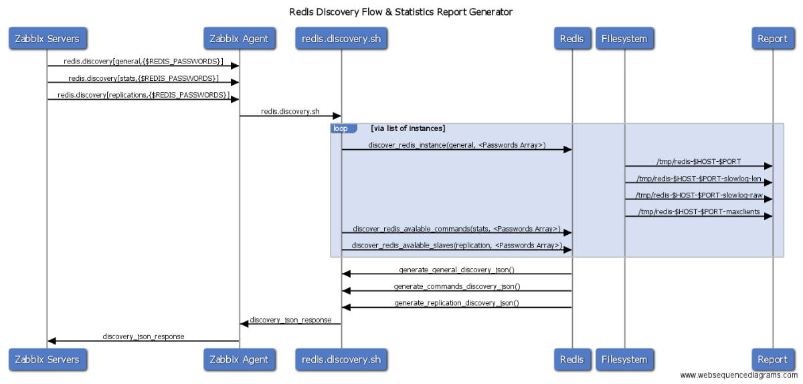

# Redis Template for Zabbix






## Table of Contents
- [Features](#features)
- [Compatibility](#compatibility)
- [Installation](#installation)
- [Installation (Optional)](#installation-optional)
- [Important](#important)
- [Debugging / Issue reporting](#debugging--issue-reporting)
- [Plans](#plans)
- [Discovery Flow ](#example-instance-discovery)
- [Discovery Examples ](#example-commands-stats-discovery)

## Features
  - Discover multiple Redis instances on the same host
  - Optional Zabbix screens (import **zbx_template_screens/zbx_export_screens_v3.xml**) for general statistics, command stats, and replication overviews at host level
  - Triggers identify command anomaly (not done yet) and instance crash

## Compatibility

This project targets **Zabbix server and proxies from 3.0 through 7.x**. Use a **Zabbix agent** whose major version matches your server (classic **zabbix_agentd** with `UserParameter` definitions matches the shipped **zabbix_agentd.d** snippets).

**Which template to import** (**Configuration → Templates → Import**; XML and JSON are equivalent):

| Your Zabbix version | Files in `zbx_template_screens/` |
| --- | --- |
| **5.x, 6.x, 7.x** | **`zbx_export_templates_v6.xml`** or **`zbx_export_templates_v6.json`** — same template, **6.4** export schema (UUIDs, `template_groups`), maintained for **5.4+ through 7.x** |
| **4.x** | **`zbx_export_templates_v4.xml`** (4.2 export) |
| **3.x** | **`zbx_export_templates_v3.xml`** |

If a **5.x** server refuses a **6.4**-format import, use **`zbx_export_templates_v4.xml`** instead (older schema that 5.x importers accept), or import **v6** on a **6.x / 7.x** instance and re-export from there after upgrade.

Further detail: **`docs/ZABBIX_TEMPLATE.md`**.

## Installation
  - Import the template that matches your Zabbix version (see [Compatibility](#compatibility)) via **Zabbix → Configuration → Templates → Import**
  - Copy **zabbix_agentd.d/zbx_redis_discovery.sh** to **/usr/bin/zbx_redis_discovery.sh** (or keep the path aligned with your **UserParameter** definitions)
  - Copy **zabbix_agentd.d/zbx_userparameters_redis.conf** into **/etc/zabbix/zabbix_agentd.d/** (or the directory your agent uses for includes)
  - Restart the Zabbix agent on hosts where you installed the script and user parameters

## Installation (OPTIONAL)
  - Replace every `<host>your.first.redis.host.local</host>` in **zbx_template_screens/zbx_export_screens_v3.xml** with the hostname of the first Redis host you monitor in Zabbix (as shown under **Configuration -> Hosts**)
  - Import **zbx_export_screens_v3.xml** via **Zabbix -> Monitoring -> Screens**

## Important
  - Make sure your redis-server configuration file ends with **.conf** otherwise INSTANCE name won't be discovered
  - Discovery produce stats files from where template gathers stats per 1 min basis, so important to leave discovery rules to run with short interval only. (current template do that each 1 min)
  - You don't have to worry about discovery process to update all items per 1 min basic, actually Zabbix Server use its own cache and perform DB update only when there is a new item appears.

## Debugging / Issue reporting
  - If **Discover Redis Instances** fails, run **`/usr/bin/zbx_redis_discovery.sh general debug`** (or the same path you configured on the agent) and attach the output to the issue
  - If **Discover Redis Commands** fails: **`/usr/bin/zbx_redis_discovery.sh stats debug`**
  - If **Discover Redis Slaves** fails: **`/usr/bin/zbx_redis_discovery.sh replication debug`**

## Plans
  - Keep pushing on Zabbix R&D to let create graphs with multiple prototype items, meanwhile use [Zabbix Grafana](https://github.com/alexanderzobnin/grafana-zabbix)

Discovery with Statistics Report Flow
===========================



**`zabbix_get` is normally run on your Zabbix server or on a Zabbix proxy** (the component that reaches the agent over TCP 10050), not on the monitored Redis host. The `-s` argument is the **agent host** as configured in Zabbix (DNS or IP). To test directly on the machine where Redis runs, call the discovery script or use `zabbix_agentd -t` there instead.

Example Instance Discovery:
===========================

```json
zabbix_get -s redis.host.me -k redis.discovery[general,"123456 123456"] | jq .
{
  "data": [
    {
      "{#HOST}": "127.0.0.1",
      "{#PORT}": "6399",
      "{#INSTANCE}": "INSTANCE1",
      "{#RDB_PATH}": "/usr/share/redis/instance1.rdb"
    },
    {
      "{#HOST}": "127.0.0.1",
      "{#PORT}": "6395",
      "{#INSTANCE}": "INSTANCE2",
      "{#RDB_PATH}": "/usr/share/redis/instance2.rdb"
    },
    {
      "{#HOST}": "127.0.0.1",
      "{#PORT}": "6397",
      "{#INSTANCE}": "INSTANCE3",
      "{#RDB_PATH}": "/usr/share/redis/instance3.rdb"
    },
    {
      "{#HOST}": "127.0.0.1",
      "{#PORT}": "6389",
      "{#INSTANCE}": "INSTANCE4",
      "{#RDB_PATH}": "/usr/share/redis/instance4.rdb"
    }
  ]
}
 ```

Example Commands Stats Discovery:
=================================
```json
zabbix_get -s redis.host.me -k redis.discovery[stats,"123456 123456"] | jq .
{
  "data": [
    {
      "{#HOST}": "127.0.0.1",
      "{#PORT}": "6399",
      "{#COMMAND}": "cmdstat_auth",
      "{#INSTANCE}": "INSTANCE1"
    },
    {
      "{#HOST}": "127.0.0.1",
      "{#PORT}": "6399",
      "{#COMMAND}": "cmdstat_ping",
      "{#INSTANCE}": "INSTANCE1"
    },
    {
      "{#HOST}": "127.0.0.1",
      "{#PORT}": "6399",
      "{#COMMAND}": "cmdstat_info",
      "{#INSTANCE}": "INSTANCE1"
    },
    {
      "{#HOST}": "127.0.0.1",
      "{#PORT}": "6399",
      "{#COMMAND}": "cmdstat_config",
      "{#INSTANCE}": "INSTANCE1"
    },
    {
      "{#HOST}": "127.0.0.1",
      "{#PORT}": "6399",
      "{#COMMAND}": "cmdstat_slowlog",
      "{#INSTANCE}": "INSTANCE1"
    },
    {
      "{#HOST}": "127.0.0.1",
      "{#PORT}": "6395",
      "{#COMMAND}": "cmdstat_auth",
      "{#INSTANCE}": "INSTANCE2"
    },
    {
      "{#HOST}": "127.0.0.1",
      "{#PORT}": "6395",
      "{#COMMAND}": "cmdstat_ping",
      "{#INSTANCE}": "INSTANCE2"
    },
    {
      "{#HOST}": "127.0.0.1",
      "{#PORT}": "6395",
      "{#COMMAND}": "cmdstat_info",
      "{#INSTANCE}": "INSTANCE2"
    },
    {
      "{#HOST}": "127.0.0.1",
      "{#PORT}": "6395",
      "{#COMMAND}": "cmdstat_config",
      "{#INSTANCE}": "INSTANCE2"
    },
    {
      "{#HOST}": "127.0.0.1",
      "{#PORT}": "6395",
      "{#COMMAND}": "cmdstat_slowlog",
      "{#INSTANCE}": "INSTANCE2"
    },
    {
      "{#HOST}": "127.0.0.1",
      "{#PORT}": "6397",
      "{#COMMAND}": "cmdstat_set",
      "{#INSTANCE}": "INSTANCE3"
    },
    {
      "{#HOST}": "127.0.0.1",
      "{#PORT}": "6397",
      "{#COMMAND}": "cmdstat_select",
      "{#INSTANCE}": "INSTANCE3"
    },
    {
      "{#HOST}": "127.0.0.1",
      "{#PORT}": "6397",
      "{#COMMAND}": "cmdstat_auth",
      "{#INSTANCE}": "INSTANCE3"
    },
    {
      "{#HOST}": "127.0.0.1",
      "{#PORT}": "6397",
      "{#COMMAND}": "cmdstat_ping",
      "{#INSTANCE}": "INSTANCE3"
    },
    {
      "{#HOST}": "127.0.0.1",
      "{#PORT}": "6397",
      "{#COMMAND}": "cmdstat_info",
      "{#INSTANCE}": "INSTANCE3"
    },
    {
      "{#HOST}": "127.0.0.1",
      "{#PORT}": "6397",
      "{#COMMAND}": "cmdstat_config",
      "{#INSTANCE}": "INSTANCE3"
    },
    {
      "{#HOST}": "127.0.0.1",
      "{#PORT}": "6397",
      "{#COMMAND}": "cmdstat_slowlog",
      "{#INSTANCE}": "INSTANCE3"
    },
    {
      "{#HOST}": "127.0.0.1",
      "{#PORT}": "6389",
      "{#COMMAND}": "cmdstat_auth",
      "{#INSTANCE}": "INSTANCE4"
    },
    {
      "{#HOST}": "127.0.0.1",
      "{#PORT}": "6389",
      "{#COMMAND}": "cmdstat_ping",
      "{#INSTANCE}": "INSTANCE4"
    },
    {
      "{#HOST}": "127.0.0.1",
      "{#PORT}": "6389",
      "{#COMMAND}": "cmdstat_info",
      "{#INSTANCE}": "INSTANCE4"
    },
    {
      "{#HOST}": "127.0.0.1",
      "{#PORT}": "6389",
      "{#COMMAND}": "cmdstat_config",
      "{#INSTANCE}": "INSTANCE4"
    },
    {
      "{#HOST}": "127.0.0.1",
      "{#PORT}": "6389",
      "{#COMMAND}": "cmdstat_slowlog",
      "{#INSTANCE}": "INSTANCE4"
    }
  ]
}
 ```
 Example Commands Stats Discovery:
 =================================
 ```json
 zabbix_get -s redis.host.me -k redis.discovery[replication] | jq .
{
  "data": [
    {
      "{#HOST}": "127.0.0.1",
      "{#PORT}": "6400",
      "{#SLAVE}": "slave0",
      "{#INSTANCE}": "INSTANCE1"
    },
    {
      "{#HOST}": "127.0.0.1",
      "{#PORT}": "6400",
      "{#SLAVE}": "slave1",
      "{#INSTANCE}": "INSTANCE1"
    },
    {
      "{#HOST}": "127.0.0.1",
      "{#PORT}": "6400",
      "{#SLAVE}": "slave2",
      "{#INSTANCE}": "INSTANCE1"
    },
    {
      "{#HOST}": "127.0.0.1",
      "{#PORT}": "6400",
      "{#SLAVE}": "slave4",
      "{#INSTANCE}": "INSTANCE1"
    },
    {
      "{#HOST}": "127.0.0.1",
      "{#PORT}": "6400",
      "{#SLAVE}": "slave5",
      "{#INSTANCE}": "INSTANCE1"
    }
  ]
}    
 ```    
